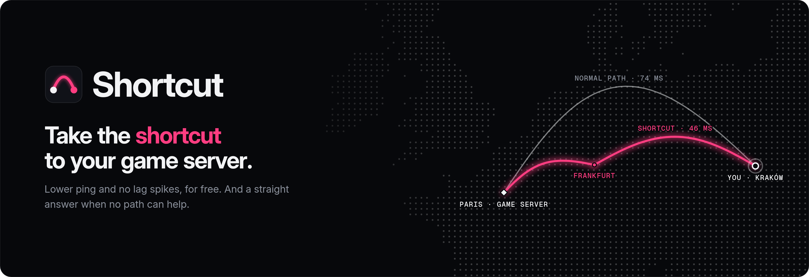
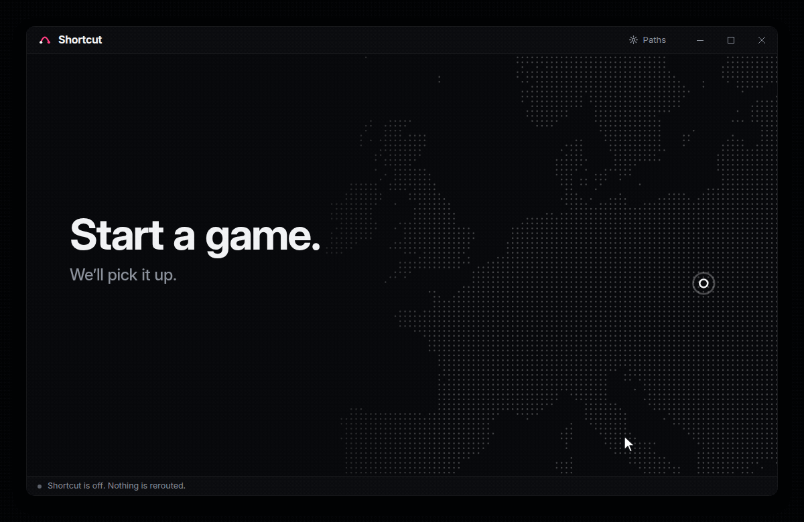
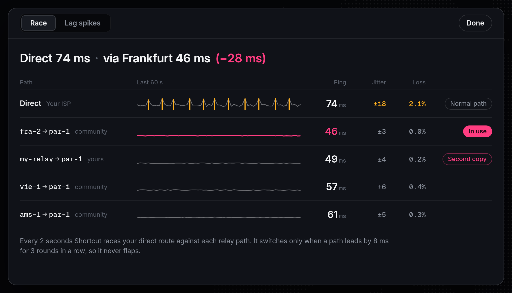
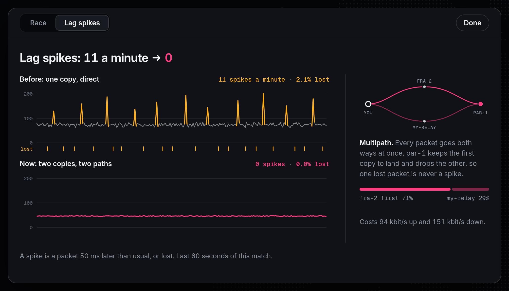
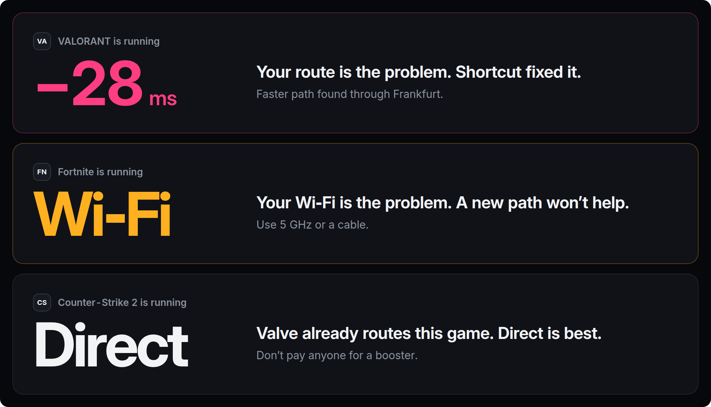
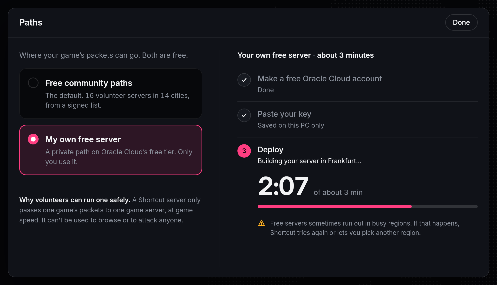

<p align="center">
  
</p>

<p align="center">
  <a href="#get-it"></a>
  <a href="LICENSE"></a>
  
  
  
</p>

<p align="center">
  <a href="#what-it-does">What it does</a> ·
  <a href="#get-it">Get it</a> ·
  <a href="#how-it-works">How it works</a> ·
  <a href="#faq">FAQ</a>
</p>

<p align="center">
  
</p>

<h3 align="center">Lower ping for free. Like ExitLag, minus the subscription.</h3>

**Lagging in ranked? Paying for ExitLag?**

Your game's packets take whatever road your internet provider picked, not the fastest one. Shortcut finds a faster road, sends only your game down it, and sends every packet twice so a lost one never turns into a lag spike. When no road can help, it tells you why instead of selling you one.

Free. No account, no ads, no telemetry.

## What it does

<table>
  <tr>
    <td width="50%"></td>
    <td width="50%"></td>
  </tr>
  <tr>
    <td valign="top"><b>A live race to your server.</b> Every 2 seconds Shortcut times your normal path against faster ones and puts your game on the winner. It only switches on a clear lead, so it never flip-flops.</td>
    <td valign="top"><b>No more lag spikes.</b> Every packet goes two ways at once, and the first copy to arrive wins. One lost packet stops being a spike.</td>
  </tr>
  <tr>
    <td></td>
    <td></td>
  </tr>
  <tr>
    <td valign="top"><b>A straight answer.</b> When your Wi‑Fi is the problem, or your normal path is already the fastest, Shortcut says so. It never sells you a fix that can't work.</td>
    <td valign="top"><b>Free servers, two ways.</b> Use free community paths, or set up your own free server in about 3 minutes. Nobody pays.</td>
  </tr>
</table>

**Also**
- One button for 20 games. Nothing to set up.
- Not a VPN. Discord, your browser and downloads stay as they are.
- No account, no ads, no telemetry.
- The relay is open source and small enough to read in one sitting.

## Get it

| System | File | |
|---|---|---|
| Windows 10 and 11 | [`game-ping-multipath-router.zip`](https://github.com/ForbiddenSealWrench/game-ping-multipath-router/releases/latest/download/game-ping-multipath-router.zip) | One zip. No installer, no admin rights |

Unpack the whole folder and start `Main.exe`. No installer, no admin rights.

`Main.exe` is code-signed, so Windows starts it without a warning. Keep
`Shortcut` next to it: they ship together.

## How it works

- **Only your game moves.** Shortcut spots the game by its process and reroutes only that process's UDP packets, through a [Wintun](https://www.wintun.net) virtual adapter (the WireGuard project's tunnel driver). It isn't a VPN and doesn't hide your IP from anyone.
- **No server lists.** It learns the match server from the game's own traffic. [`games.toml`](games.toml) only lists games and their process names.
- **The race.** Every 2 seconds it times small probes on your direct route and on each relay path, and scores ping, jitter and loss. It switches when a path leads by 8 ms for 3 rounds in a row. Mid-match it only changes the path into the exit relay near the server, never the exit itself, so the server keeps seeing one address.
- **Multipath.** Each packet goes down two relay paths. The exit relay keeps the first copy of each one and drops the late twin, and your PC does the same on the way back. It costs a little bandwidth, and the app shows how much.
- **Why it can be free.** Paid boosters run servers and charge for them. Shortcut's relays cost nothing:
  - **Your own.** The wizard deploys [`shortcut-relay`](crates/shortcut-relay) to Oracle Cloud's Always Free tier with [`relay/cloud-init.yaml`](relay/cloud-init.yaml), building it from this repo's source. Always Free includes Arm (Ampere A1) VMs and 10 TB of outbound traffic a month, far more than gaming needs. Free Arm capacity sometimes runs out in busy regions, and the wizard tells you when it does.
  - **The community's.** A signed list of volunteer relays by city, [`relays.toml`](relays.toml).
- **Safe to volunteer.** A relay forwards only UDP, only to the one public address a session registered, and at up to 1 Mbit/s. It checks that a player really receives at their address before opening a session. It can't be used as an open proxy or for web traffic, and it keeps no logs of who connects.
- **Honest first.** Wi‑Fi, bufferbloat and background downloads are checked before the route gets the blame, because no route fixes them. Valve games (CS2, Dota 2, Deadlock) already ride Valve's own relay network, so a better path is rare and Shortcut says so. It shows measured numbers, never promised percentages.

## Build from source

You need Rust 1.85 or newer, plus the [Tauri prerequisites](https://v2.tauri.app/start/prerequisites/) for the desktop app.

```bash
git clone https://github.com/ForbiddenSealWrench/game-ping-multipath-router.git
cd shortcut
cargo test --workspace
cargo tauri build          # the desktop app
```

| Path | What's inside |
|---|---|
| `crates/shortcut-core` | Scoring, switching, multipath, the relay rule |
| `crates/shortcut-relay` | The relay, std only |
| `relay/cloud-init.yaml` | A relay on any fresh Linux VM |
| `app/` | The window and its icons |

## FAQ

<details>
<summary><b>Will it lower my ping?</b></summary>

Only if a faster path exists, and the app shows you the measured numbers either way. If your direct route is already the fastest, or your Wi‑Fi is the real problem, Shortcut tells you and stays out of the way.
</details>

<details>
<summary><b>Is it really free? Who pays for the servers?</b></summary>

Nobody. Community relays are run by volunteers, and your own relay sits on Oracle Cloud's Always Free tier. Oracle asks for a card to verify your account, and Always Free resources aren't charged. Oracle can reclaim a free VM that sits idle for a long time; redeploying takes the same 3 minutes.
</details>

<details>
<summary><b>Does it touch the game or anti-cheat?</b></summary>

No. Shortcut never reads or changes the game's files or memory. It only changes the path the game's packets take across the internet, the way a different internet provider would.
</details>

<details>
<summary><b>What can a relay see?</b></summary>

The game packets passing through it, like any router on the internet, and nothing else on your PC. Your Oracle key stays on your PC. Shortcut itself sends no telemetry.
</details>

<details>
<summary><b>Is Shortcut like ExitLag or NoPing?</b></summary>

Same trick, no subscription. They pay for servers and charge you. Shortcut runs on free relays: your own on a free cloud tier, or the community's. And when your Wi-Fi is the problem, it says so instead of selling you a route.
</details>

## License

Shortcut is [MIT](LICENSE) licensed. The UI prefers the system font where it has one (SF Pro on Apple devices) and bundles Inter and Geist Mono, both under the SIL Open Font License 1.1.

ExitLag, NoPing and Oracle Cloud are named for comparison or as an option only. Game names are trademarks of their owners. Shortcut isn't affiliated with any of them.

---

Reviewed with [Claude](https://claude.ai) — the AI assistant from Anthropic.
